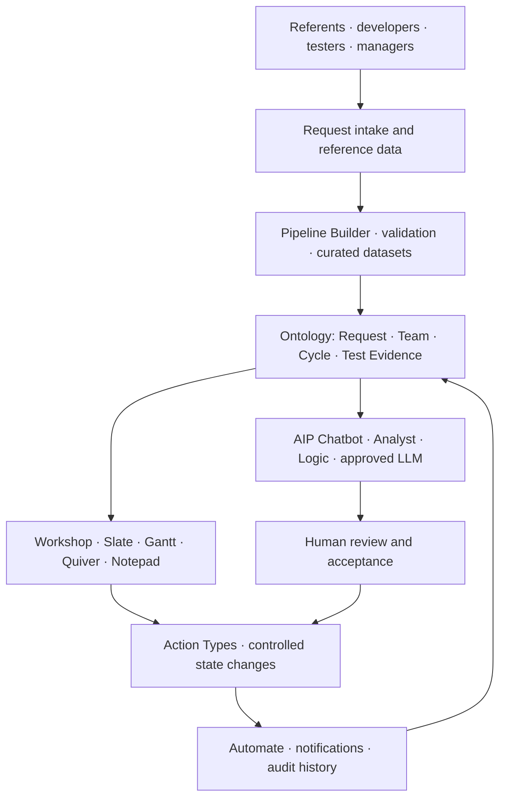
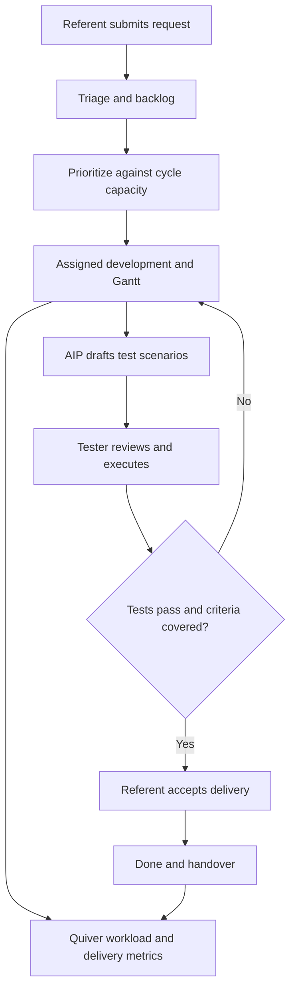

# Delivery Bridge

Delivery Bridge is a proposed Palantir Foundry solution for tracking requests from intake through development, testing and business acceptance, with capacity planning, delivery analytics and human-reviewed AI test drafting.

**Architecture portfolio · Palantir Foundry · Ontology · AIP · Human-reviewed decisions**

## Why this project exists

Business referents and developers often track the same request differently. Priorities, ownership, implementation progress and test evidence become disconnected. Delivery Bridge brings the request lifecycle into one ontology-backed workspace, with explicit handoffs and a traceable definition of done.

**Intended outcome:** Follow a request from intake and prioritization through implementation, testing and business acceptance, while comparing planned effort with available capacity.

## Solution design

The editable [Solution Designer JSON](docs/diagrams/solution-design.json) accompanies the architecture and can be imported into the matching tool. See [the component and data flow details](docs/architecture.md).

## What the design covers

- Structured request intake and ownership
- Proposed three-week planning and Gantt timeline
- Effort-based workload and capacity analysis
- Controlled transitions with timestamped event history
- AI-assisted test drafting and human validation
- Cycle reviews, blocker analysis and delivery handover

## Who uses it

Business referents define needs and accept delivery; developers implement requests; testers record verification evidence; managers prioritize work and balance capacity.

## End-to-end workflow

## Start here

1. Read the [architecture and tool responsibilities](docs/architecture.md).
2. Inspect the [ontology and data contracts](docs/ontology.md).
3. Follow the [workflow and business rules](docs/workflows.md).
4. Review the [AIP and automation design](docs/aip-and-automation.md).
5. Walk through the [synthetic example](examples/README.md).
6. Use the [implementation and validation guide](docs/implementation.md) to plan a Foundry build.

## Example scenario

A fictional team receives a request for an inventory dashboard. A manager assigns it to a three-week cycle, a developer implements it, AIP proposes test scenarios, and a tester verifies them. Completion requires passing required tests and business acceptance.

## Repository contents

| Path | Contents |
| --- | --- |
| `docs/diagrams/solution-design.png` | Full-resolution architecture diagram |
| `docs/diagrams/solution-design.json` | Editable Solution Designer diagram |
| `docs/architecture.md` | Layers, component roles and engineering decisions |
| `docs/ontology.md` | Object grains, links, keys and data ownership |
| `docs/workflows.md` | States, actions, calculations and completion rules |
| `docs/aip-and-automation.md` | AI inputs/outputs, review gates and automation triggers |
| `docs/implementation.md` | Suggested build sequence, validation and operations |
| `examples/` | Fictional records and an illustrative walkthrough |
| `docs/references.md` | Official Palantir capability references |

## Status and scope

This is a **conceptual solution-design repository**, not a deployable Foundry application. It contains documentation, diagrams and synthetic records; it does not contain production code, provisioned ontology objects, live connections or configured AI agents. Detailed schemas, formulas and workflow rules are proposed implementation choices.

Importing the JSON draws the solution architecture; it does not create Foundry resources. Some tools appear as generic custom cards for compatibility with the supplied export format. The JSON has been structurally validated; import behavior depends on your Solution Designer version.

## Technology coverage

Ontology Manager, Workshop, Slate, Action Types, PySpark, TypeScript, Code Repositories, Pipeline Builder, Scheduler, Automate, Quiver, Notepad, Gantt Chart, AIP Chatbot, AIP Analyst, AIP Logic and LLMs.

## Contributing

Suggest changes with a clear problem statement and the affected documentation or diagram. Keep examples fictional, state assumptions explicitly, and update the ontology and workflow references when a design changes. Do not submit credentials, internal URLs or organization-specific data.
